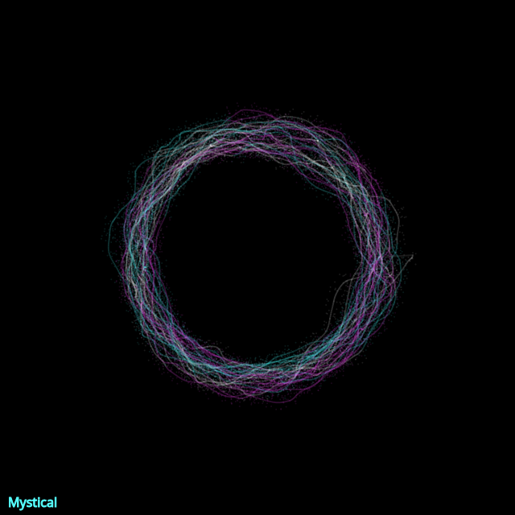

```javascript
let white;
let cyan;
let magenta;

class Walker {
  constructor() {
    this.r = 150;
    this.h = width/2;
    this.k = height/2;
    this.tx = 0;
    this.ty = 10000;
    this.x = this.r * cos(this.tx) + this.h;
    this.y = this.r * sin(this.tx) + this.k;
    this.lastx = this.x;
    this.lasty = this.y;
  }

  step() {
    this.tx += 0.01;
    this.ty += 0.01;
    this.lastx = this.x;
    this.lasty = this.y;

    this.x = this.r * cos(this.tx) + this.h + map(noise(this.tx), 0, 1, -50, 50);
    this.y = this.r * sin(this.tx) + this.k + map(noise(this.ty), 0, 1, -50, 50);
    
    if (random() < 0.01) {
      stroke(random([white,cyan,magenta]));
    }
  }

  show() {
    line(this.x,this.y,this.lastx,this.lasty);
    point(
      this.x + random(-10, 10),
      this.y + random(-10, 10)
    );
  }
}

let w;

function setup() {
  createCanvas(640, 640);
  background(0);

  white = color(255,255,255, 25);
  cyan = color(85,255,255, 25);
  magenta = color(255,85,255, 25);

  stroke("#55ffff");
  fill("#55ffff");
  textSize(16);
  text("Mystical", 10, height-10);
  
  stroke(white);
  strokeWeight(3);
  
  w = new Walker();

}

function draw() {
  w.step();
  w.show();
}

function keyPressed() {
  if (key=='s') {
    saveCanvas("mystical.png");
  }
}
```
