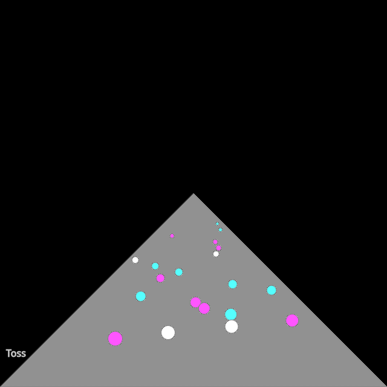

```javascript
const white = "#fff";
const cyan = "#55ffff";
const magenta = "#ff55ff";

function setup() {
  createCanvas(640, 640);
  background(0);

  // 1. Create a tiny 2x2 grid for a checkerboard/dither pattern
  patternImg = createGraphics(2, 2);
  patternImg.noStroke();
  patternImg.background(250);          // Primary color
  patternImg.fill(40);                 // Secondary dither color
  patternImg.rect(0, 0, 1, 1);
  patternImg.rect(1, 1, 1, 1);

  // 2. Convert p5.Graphics to an HTML Canvas Pattern
  let ctx = drawingContext;
  let pattern = ctx.createPattern(patternImg.canvas, 'repeat');

  // 3. Apply pattern fill and draw standard p5 shapes
  ctx.fillStyle = pattern;
  stroke(127);
  strokeWeight(1);

  triangle(0, height, width/2, height/2, width, height);
  
  for(let i = 5; i < 25; i++) {
    fill(random([white,cyan,magenta]));
    circle(
      width/2 + random(-i*10, i*10),
      height/2+i*10,
      i
    );
  }
  
  stroke(200);
  fill(200);
  textSize(16);
  text("Toss", 10, height-50);
}

function draw() {
}

function keyPressed() {
  if (key == 's') {
    saveCanvas("toss.png");
  }
}
```
