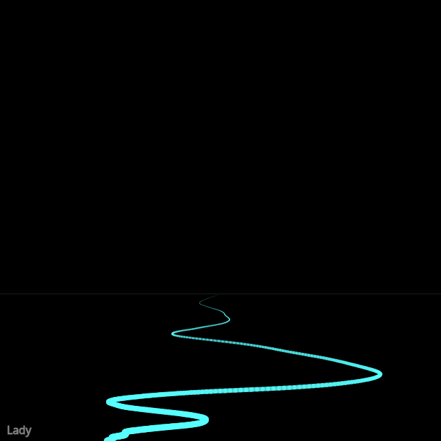

```javascript
const white = "#fff";
const cyan = "#55ffff";
const magenta = "#ff55ff";
const colors = [white, cyan, magenta];

class Walker {
  constructor() {
    this.tx = 0;
    this.ty = 10000;
    this.x = width/2;
    this.y = height-height/3;
    this.lastx = this.x;
    this.lasty = this.y;
  }

  step() {
    if (this.y >= height) {
      return;
    }
    
    this.tx += 0.02;
    this.ty += 0.01;
    this.lastx = this.x;
    this.lasty = this.y;
    
    let xnoise = map(noise(this.ty), 0, 1, -20, 20);
    let ynoise = map(noise(this.ty), 0, 1, 0, 1);
    
    if (this.x < width/2) {
      xnoise += dist(this.x, 0, width/2, 0) * 0.05;
    }
    if (this.x > width/2) {
      xnoise -= dist(this.x, 0, width/2, 0) * 0.05;
    }

    this.x += xnoise;
    this.y += ynoise;
  }

  show() {
    if (this.y >= height) {
      return;
    }
    stroke(color(88, 255, 255, map(this.y, height-height/3, height, 100, 255)));
    strokeWeight(map(this.y, height-height/3, height, 0, 10));
    line(this.x, this.y, this.lastx, this.lasty);
  }
}

let walker;

function setup() {
  createCanvas(640, 640);
  background(0);

  stroke(127);
  fill(127);
  textSize(16);
  text("Lady", 10, height-10);

  stroke(white);
  strokeWeight(0.1111);
  noFill();

  line(0, height-height/3, width, height-height/3);
  
  walker = new Walker();
}

function draw() {
  walker.step();
  walker.show();
}

function keyPressed() {
  if (key == "s") {
    saveCanvas("lady.png");
  }
}
```
