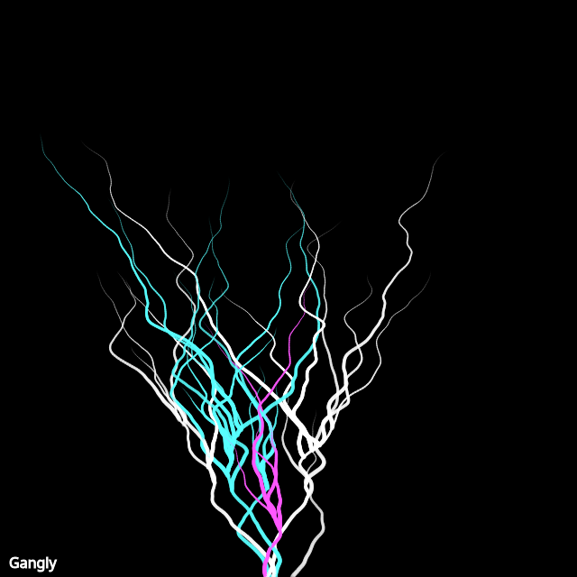

## Animation

<div id="canvas-container"></div>
<script src="https://cdn.jsdelivr.net/npm/p5@2.3.3/lib/p5.min.js"></script>
<script src="../../assets/js/gentober2026/day16.js"></script>

This is the first post where I'm including an animated version of the sketch. I'm not sure if I'm going to continue doing this but after Bob and I talked yesterday we were curious if it was possible to include that in these posts. Here you go Bob!

## Static



## Code

```javascript
const white = [255,255,255];
const cyan = [88, 255, 255];
const magenta = [255, 88, 255];
const colors = [white, cyan, magenta];

class Walker {
  constructor(x, y, c, g) {
    this.x = x;
    this.y = y;
    this.lastx = this.x;
    this.lasty = this.y;
    this.tx = random(0, 1000);
    this.ty = random(1000, 9999);
    this.color = c;
    this.lean = random(-1, 1);
    this.age = 0;
    this.lifespan = random(5, 23);
    this.alpha = random(127, 255);
    this.gangly = g;
  }

  update() {
    this.tx += random(0.05, 0.08);
    this.ty += random(0.01, 0.05);
    this.lastx = this.x;
    this.lasty = this.y;
    this.x += map(noise(this.tx), 0, 1, -3, 3) + this.lean;
    this.y += map(noise(this.ty), 0, 1, -2, -1); // tend up
    this.age += 0.1;
    if (this.gangly 
        && random() < 0.1 
        && this.age < this.lifespan/2 
        && this.age > this.lifespan/4) {
      this.gangly.sprout(this.x, this.y, this.color);
    }
  }

  show() {
    if (this.age < this.lifespan) {
      stroke(...this.color, this.alpha);
      strokeWeight(map(this.age, 0, this.lifespan, 5, 0));
      line(this.x, this.y, this.lastx, this.lasty);
    }
  }
}

class Gangly {
  constructor(x, y, nStrands) {
    this.x = x;
    this.y = y;
    this.nStrands = nStrands;
    this.strands = [];
    for (let i = 0; i < nStrands; i++) {
      this.strands.push(new Walker(x+random(-25,25), y, random(colors), this));
    }
  }

  sprout(x, y, c) {
    this.strands.push(new Walker(x, y, c));
  }

  update() {
    for (const strand of this.strands) {
      strand.update();
    }
  }

  show() {
    for (const strand of this.strands) {
      strand.show();
    }
  }
}

let g;

function setup() {
  createCanvas(640, 640);
  background(0);
  showTitle();
  g = new Gangly(width/2, height, random(5, 25));
}

function showTitle() {
  stroke(255);
  fill(255);
  strokeWeight(1);
  textSize(16);
  text("Gangly", 10, height-10);
}

function draw() {
  g.update();
  g.show();
}

function keyPressed() {
  if (key == "s") {
    saveCanvas("gangly.png");
  }
}
```

## Discussion

The word "gangly" means awkward skinny lanky limbs on a person. Tall and skinny. Sometimes it's used to describe the legs of animals I guess. It feels bouncy in my mouth when I say it out loud, the tongue hits the teeth a bit. Anyway... I suppose this is the first post where I am trying to describe my thinking (per Bob's suggestion). I think I limbs reminds me of tree branches or trunks. I suppose after thinking about tree limbs I remembered the walker and how I could use that to make something "bush-like". I created a walker and did something basic with a single limb and liked how it looked. We can use perlin noise to make the growth of the limb look natural and have some variation. I combined this with an age variable so I could reduce the strokeWeight as the limb grows and age it down to a sharp point at the top end. Modify the walker to always grow upward and give random limbs a "lean" to the left or right and you end up with something vaguely like a growing limb. Threw on some random colors and random alphas just to differentiate them a bit.

The last thing I did was to add sprouts. A sprout is a probabilistic split around lifespan/4-/2 and this new limb gets added to the whole starting from that x,y coordinate. It's a nice little graphic and grows up until the limbs age out.

I think for future variations on this I'd like to play with keeping the variation but making the segments straight lines so it looks like a growing crack or crystal. I also want to play with creating multiple of these gangly groupings and having them vary in other ways.
