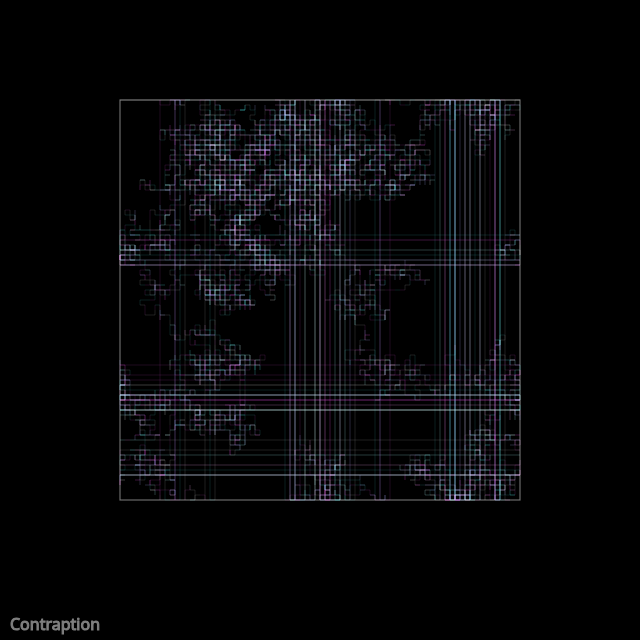

## Animated

<div id="canvas-container"></div>
<script src="https://cdn.jsdelivr.net/npm/p5@2.3.3/lib/p5.min.js"></script>
<script src="../../assets/js/gentober2026/day17.js"></script>

## Static



## Code

```javascript
const white = [255, 255, 255];
const cyan = [255, 88, 255];
const magenta = [88, 255, 255];
const colors = [white, cyan, magenta];

class Walker {
  constructor(x,y,lowx,lowy,highx,highy) {
    this.x = x;
    this.y = y;
    this.lastx = x;
    this.lasty = y;
    this.lowx = lowx;
    this.lowy = lowy;
    this.highx = highx;
    this.highy = highy;
  }

  update() {
    this.lastx = this.x;
    this.lasty = this.y;
    if (random() < 0.5) {
      this.x += random() < 0.5 ? -5 : 5;
    } else {
      this.y += random() < 0.5 ? -5 : 5;
    }
    if (this.x < this.lowx) this.x = this.highx;
    if (this.x > this.highx) this.x = this.lowx;
    if (this.y < this.lowy) this.y = this.highy;
    if (this.y > this.highy) this.y = this.lowy;
  }

  show() {
    stroke(...random(colors), 30);
    noFill();
    line(this.x, this.y, this.lastx, this.lasty);
  }
}

let w;

function setup() {
  createCanvas(640, 640);
  background(0);

  // frame
  stroke(127);
  noFill();
  square(120,100, 400);

  w = new Walker(120, 100, 120, 100, 120+400, 100+400);
  
  // title
  stroke(127);
  fill(127);
  textSize(16);
  text("Contraption", 10, height-10);
}

function draw() {
  w.update();
  w.show();
}

function keyPressed() {
  if (key == "s") {
    saveCanvas("contraption.png");
  }
}
```

## Discussion

I think contraption feels to me a bit like Ram did previously, that is a machine of some sort. In this case is it the "machine-like" drawing or the machine drawing the drawing? I decided to add a frame to give the contraption some space and feel more like a contained object. I think the lines from top to bottom and left to right jumps (due to the lastx/lasty variable handling) are nice and add to the strange feel of the contraption.

Something I think might be lost if work like this was done with generative AI is that you give up the exploration of behavior with your own mind and the underlying details. That's not to say one shouldn't use AI, just think deliberately about how to use it. Perhaps do a piece twice with both methods. Perhaps start with an AI generated starting point and then add to it. Maybe start with your own exploration and then have AI remix some aspect of it. I don't want to lose the _discovery_ aspect of what I'm doing is the key thought for me. The jumping vertical and horizontal lines of this piece were discovered, not intended, and I think that's valuable.