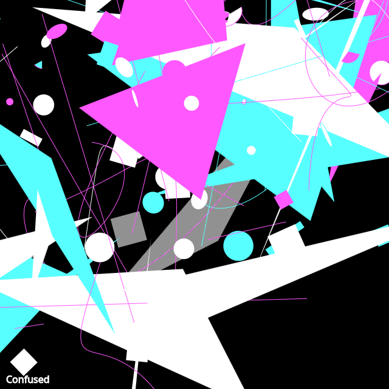

## Code

```javascript
const white = [255, 255, 255];
const cyan = [88, 255, 255];
const magenta = [255, 88, 255];
const colors = [white, cyan, magenta];

async function setup() {
  createCanvas(640, 640);
  background(0);

  stroke(255);
  fill(255);
  textSize(16);
  text("Confused", 10, height - 10);

  // black and white pattern
  patternImg = createGraphics(2, 2);
  patternImg.noStroke();
  patternImg.background(250);
  patternImg.fill(40);
  patternImg.rect(0, 0, 1, 1);
  patternImg.rect(1, 1, 1, 1);
  let ctx = drawingContext;
  let pattern = ctx.createPattern(patternImg.canvas, 'repeat');
  ctx.fillStyle = pattern;

  for (let i = 0; i < 50; i++) {
    rotate(random(0, PI));
    noStroke();

    if (random() < 0.1) {
      ctx.fillStyle = pattern;
    } else {
      fill(random(colors));
    }
    
    triangle(random(0,width), random(0,height),
            random(0,width), random(0,height),
            random(0,width), random(0,height));
    square(random(0,width), random(0,height), random(5, 50));
    circle(random(0,width), random(0,height), random(5, 50));
    rect(random(0,width), random(0,height), random(5, 50), random(5, 50));
    ellipse(random(0,width), random(0,height), random(5,50), random(5,50));

    stroke(random(colors));
    line(random(0,width), random(0,height), random(width), random(height));
    arc(random(0,width), random(0,height), random(5, 50), random(5, 50),
       random(0, PI), random(0, PI));

    noFill();
    bezier(random(0,width), random(0,height),
          random(0,width), random(0,height),
          random(0,width), random(0,height),
          random(0,width), random(0,height));
  }
}

function draw() {
  
}

function keyPressed() {
  if (key == "s") {
    saveCanvas("confused.png");
  }
}
```