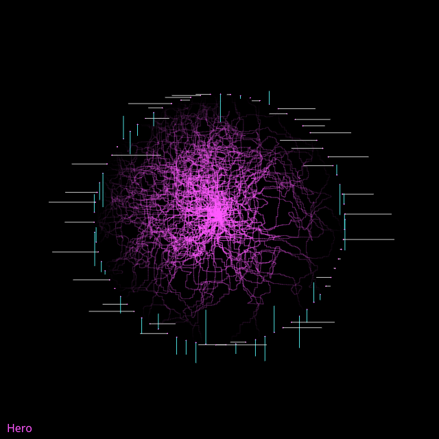

## Animated

<div id="canvas-container"></div>
<script src="https://cdn.jsdelivr.net/npm/p5@2.3.3/lib/p5.min.js"></script>
<script src="../../assets/js/gentober2026/day21.js"></script>

## Static



## Code

```javascript
const white = [255, 255, 255];
const cyan = [88, 255, 255];
const magenta = [255, 88, 255];
const colors = [white, cyan, magenta];

class Walker {
  constructor(x, y, c) {
    this.x = x;
    this.y = y;
    this.color = c;
    this.lastx = x;
    this.lasty = y;
    this.tx = random(0, 100);
    this.ty = random(999, 9999);
    this.r = width/3.5;
  }

  update() {
    this.lastx = this.x;
    this.lasty = this.y;
    if (random() > 0.5) {
      this.x += map(noise(this.tx), 0, 1, -5, 5);
    } else {
      this.y += map(noise(this.ty), 0, 1, -5, 5);
    }
    
    this.tx += 0.02;
    this.ty += 0.02;
  }

  show() {
    let centerdist = dist(this.x,this.y,width/2,height/2);
    let aph = map(centerdist, 0, this.r, 200, 0);
    if (centerdist > this.r) {
      this.x = width/2;
      this.y = width/2;
    }
    stroke(...this.color, aph);
    line(this.lastx, this.lasty, this.x, this.y);
  }
}

let walkers = [];

function setup() {
  createCanvas(640, 640);
  background(0);
  stroke(255);

  const r = width/3.5;
  const h = height/2;
  const w = width/2;
  for (let i = 0; i < 2*PI; i += 0.08) {
    let x = r * cos(i) + w;
    let y = r * sin(i) + h;
    stroke(magenta);
    circle(x,y,1);

    if (random() < 0.5) {
      stroke(...white, 200);
      line(x, y, x + random(-75, 75), y);
    } else {
      stroke(...cyan, 225);
      line(x, y, x, y + random(-50, 50));
    }
  }

  for (let j = 0; j < 10; ++j) {
    walkers.push(new Walker(width/2, height/2, magenta));
  }
  
  noStroke();
  fill(magenta);
  textSize(16);
  text("Hero", 10, height - 10);
}

function draw() {
  for (let w of walkers) {
    w.update();
    w.show();
  }
}

function keyPressed() {
  if (key == "s") {
    saveCanvas("hero.png");
  }
}
```

## Discussion

Today's prompt was difficult. When I read the word "Hero" I thought of a point of light in my head. I don't know why I had that reaction but I guess it could mean something. I decided for the piece I wanted something circular. The sun is a hero in some ways. Didn't want to make a crude landscape with a sun, I think it would look silly. I'm starting to feel like leaning more into symbolic or just very tenuous thoughts or feelings linking to the prompt. I'm not super happy with the landscape-like or more direct creation of objects I've done thus far. Like Cactus, which was fun to make but otherwise I'm not that happy with it. It feels a bit too representational.

I made a circle of white dots similar to how I started mystical awhile back. From there I added random short line segments extending from those points. At that point I had my piece. I don't know why but for some reason seeing the circle of points and the lines and how they prompted my mind into filling in the circle I knew that's where I wanted this to go. The center also followed quickly for some reason. I like how when you leave the animation going for a long time the center magenta "crackling" seems to make an eye looking off in some seemingly random direction. In a way the piece feels symbolic and accidentally representational.
