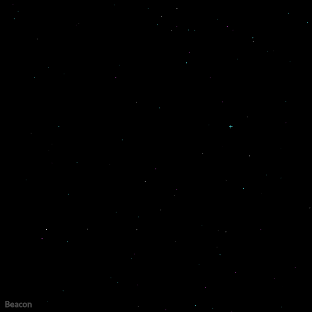

## Animated

<div id="canvas-container"></div>
<script src="https://cdn.jsdelivr.net/npm/p5@2.3.3/lib/p5.min.js"></script>
<script src="../../assets/js/gentober2026/day22.js"></script>

## Static



## Code

```javascript
const white = [255,255,255];
const cyan = [88, 255, 255];
const magenta = [255, 88, 255];
const colors = [white, cyan, magenta];

function showTitle() {
  stroke(75);
  fill(75);
  textSize(16);
  text("Beacon", 10, height - 10);
}

class Star {
  constructor(x, y) {
    this.x = x;
    this.y = y;
    this.color = random(colors);
    this.isBeacon = false;
    this.tbright = random(0, 10000);
    this.alph = random(50, 255);
  }

  setBeacon(isBeacon) {
    this.isBeacon = isBeacon;
  }

  update() {
  }

  show() {
    stroke(...this.color, this.alph);
    circle(this.x, this.y, random());
    if (this.isBeacon) {
      stroke(...this.color, random(0, 255));
      const n = random(0,5);
      line(this.x - n, this.y, this.x + n, this.y);
      line(this.x, this.y - n, this.x, this.y + n);
    }
  }
}

const stars = [];

function setup() {
  createCanvas(640, 640);
  background(0);

  for (let i = 0; i < 100; i++) {
    stars.push(new Star(random(0,width), random(0,height)));
  }

  random(stars).setBeacon(true);
  
  showTitle();
}

function draw() {
  background(0);
  
  for (let s of stars) {
    s.update();
    s.show();
  }

  showTitle();
}

function keyPressed() {
  if (key == "s") {
    saveCanvas("beacon.png");
  }
}
```

## Discussion

Today's prompt is better viewed animated I think than static. It's the first prompt where what I envisioned before starting was imagined first as an animation rather than a static image. A beacon in this case is a brighter blinking star.

The blinking beacon star is pretty mundane as far as code goes here but what I thought was a nice touch was the flickering of the other stars. I wanted something that gave the appearance of flickering stars and started out with all sorts of noise calculations but a simple random on the radius of the circle between 0 and 1 was the nicest. Obviously stars don't all flicker this intensely in the real sky but I think it gave the animation a certain vibe that implies the dots should be seen as "stars" and not just random dots on a field. It's interesting that my brain wanted to see some sort of flickering behavior in order to see them as stars when in reality it's not quite the same. Almost as if in order for me to see what I representationally imagined I needed to make the representation non-conforming in some way compared to reality.

Something else that might be a nice improvement to this would be clustering of sorts rather than uniform randomness of the star locations. When you look through a telescope it's often the case to see a slight clustering or grouping of stars, sometimes in the same color.