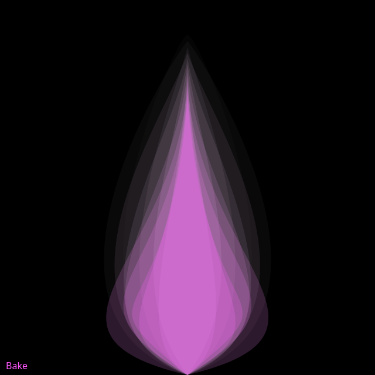

## Animated

<div id="canvas-container"></div>
<script src="https://cdn.jsdelivr.net/npm/p5@2.3.3/lib/p5.min.js"></script>
<script src="../../assets/js/gentober2026/day24.js"></script>

## Static



## Code

```javascript
const white = [255,255,255];
const cyan = [88, 255, 255];
const magenta = [255, 88, 255];
const colors = [white, cyan, magenta];

function setup() {
  createCanvas(640, 640);
  background(0);

  noStroke();
  fill(...white, 25);
}

let tx1 = 0;
let tx2 = 500;
let ty1 = 10000;
let nLayers = 13;

function draw() {
  background(0);
  
  for (let i = 1; i < nLayers; i++) {
    fill(255, map(i, 1, nLayers, 255, 88), 255, 5*i);
    let n1 = noise(tx1+i);
    let slice = height/nLayers;
    
    bezier(
      width/2,
      50+i*10,
      
      map(noise(tx1+i), 0, 1, width/2-50, width/2),
      slice*i,
      
      map(noise(tx2+i), 0, 1, width/2-400, width/2),
      map(noise(ty1+i), 0, 1, height-200, height),
      
      width/2,
      height
    );

    bezier(
      width/2,
      50+i*10,
      
      map(noise(tx1+i), 0, 1, width/2+50, width/2),
      slice*i,
      
      map(noise(tx2+i), 0, 1, width/2+400, width/2),
      map(noise(ty1+i), 0, 1, height-200, height),
      
      width/2,
      height
    );

    tx1 += 0.001;
    tx2 += 0.002;
    ty1 += 0.003;
  }

  
  fill(magenta);
  textSize(16);
  text("Bake", 10, height-10);
}

function keyPressed() {
  if (key == "s") {
    saveCanvas("bake.png");
  }
}
```
