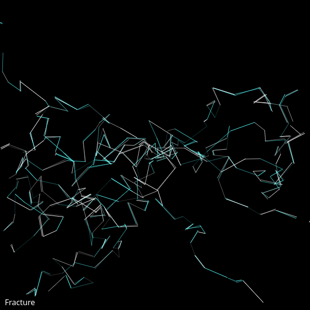

## Animated

<div id="canvas-container"></div>
<script src="https://cdn.jsdelivr.net/npm/p5@2.3.3/lib/p5.min.js"></script>
<script src="../../assets/js/gentober2026/day25.js"></script>

## Static



## Code

```javascript
const white = [255,255,255];
const cyan = [88, 255, 255];
const magenta = [255, 88, 255];
const colors = [white, cyan, magenta];

class Fracture {
  constructor(x, y) {
    this.x = x;
    this.y = y;
    this.lastx = x;
    this.lasty = y;
    this.tx = 0;
    this.ty = 10000;
    this.dirx = random([-1,1]);
    this.diry = random([-1,1]);
  }

  update() {
    this.tx += 0.01;
    let distx = map(noise(this.tx), 0, 1, 5, 20);
    let disty = map(noise(this.ty), 0, 1, 5, 20);
    
    this.lastx = this.x;
    this.lasty = this.y;
    this.x += distx * this.dirx + random(-40,40);
    this.y += disty * this.diry + random(-40,40);
  }

  show() {
    if (this.x > 0 && this.x < width && this.y > 0 && this.y < height) {
      stroke(...random([white,cyan]), random([50, 100, 150, 200, 250]));
      line(this.x, this.y, this.lastx, this.lasty);
      if (random() < 0.5) {
        stroke(...random([white,cyan]), random([50, 100, 150, 200, 250]));
        line(
          this.x + random(-3, 3),
          this.y + random(-3, 3),
          this.lastx + random(-3, 3),
          this.lasty + random(-3, 3)
        )
      }
    }
  }
}

let fracture;
let fractures = [];

function setup() {
  createCanvas(640, 640);
  background(0);

  for (let i = 0; i < 15; ++i) {
    fractures.push(new Fracture(
      random(width/2-20,width/2+20), random(height/2+20, height/2-20)));
  }
  
  fill(...white, 25);

  fill(white);
  textSize(16);
  text("Fracture", 10, height-10);

  stroke(255);
}

function draw() {
  for (let f of fractures) {
    f.update();
    f.show();
  }
}

function keyPressed() {
  if (key == "s") {
    saveCanvas("fracture.png");
  }
}
```