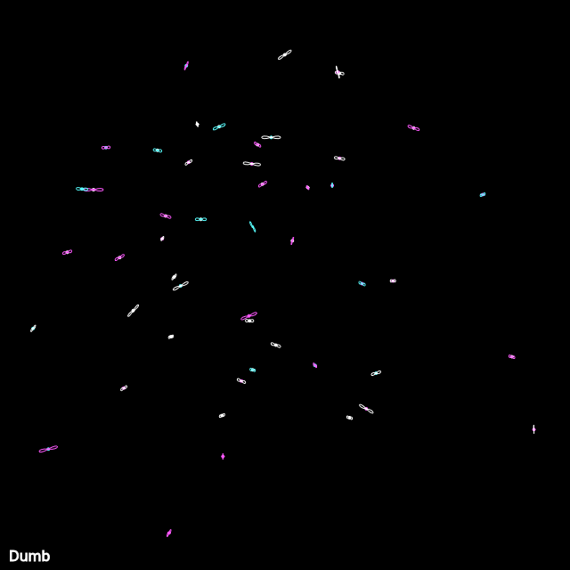

## Animated

<div id="canvas-container"></div>
<script src="https://cdn.jsdelivr.net/npm/p5@2.3.3/lib/p5.min.js"></script>
<script src="../../assets/js/gentober2026/day27.js"></script>

## Static



## Code

```javascript
const white = [255,255,255];
const cyan = [88, 255, 255];
const magenta = [255, 88, 255];
const colors = [white, cyan, magenta];

function getPerpendicularEndpoint(x, y, lastX, lastY, length, direction = 'left') {
  const dx = lastX - x;
  const dy = lastY - y;
  const dst = Math.hypot(dx, dy);

  // Avoid division by zero if points are identical
  if (dst === 0) return { x, y };

  // Perpendicular unit vector
  let ux, uy;
  if (direction === 'left') {
    ux = -dy / dst;
    uy = dx / dst;
  } else {
    ux = dy / dst;
    uy = -dx / dst;
  }

  return {
    x: x + ux * length,
    y: y + uy * length
  };
}

class Dumbo {
  constructor(x, y, c) {
    this.x = x;
    this.y = y;
    this.lastx = x;
    this.lasty = y;
    this.tx = random(0, 100);
    this.ty = random(9999, 99999);
    this.color = c;
  }

  update() {
    this.lastx = this.x;
    this.lasty = this.y;
    this.x += map(noise(this.tx), 0, 1, -1, 1);
    this.y += map(noise(this.ty), 0, 1, -1, 1);

    if (this.x > width-30 || this.x < 30) {
      this.x = width/2;
    }

    if (this.y > height-30 || this.y < 30) {
      this.y = height/2;
    }

    this.tx += 0.01;
    this.ty += 0.01;
  }

  show() {
    fill(this.color);
    circle(this.x, this.y, 3);

    stroke(this.color);
    noFill();

    let r = random(1, 10);
    let pl = getPerpendicularEndpoint(this.x, this.y, this.lastx, this.lasty, r, 'left');
    let pr = getPerpendicularEndpoint(this.x, this.y, this.lastx, this.lasty, r, 'right');
    
    bezier(
      this.x, this.y,
      pl.x-5, pl.y+5,
      pl.x-5, pl.y-5,
      this.x, this.y
    );
    
    bezier(
      this.x, this.y,
      pr.x+5, pr.y-5,
      pr.x+5, pr.y+5,
      this.x, this.y
    );
  }
}

let ds = [];

function setup() {
  createCanvas(640, 640);

  for (let i = 0; i < 50; ++i) {
    ds.push(new Dumbo(random(0, width), random(0, height), random(colors)));
  }
}

function draw() {
  background(0);
  noStroke();

  for (let d of ds) {
    d.update();
    d.show();
  }

  fill(white);
  stroke(white);
  textSize(16);
  text("Dumb", 10, height-10);
}

function keyPressed() {
  if (key == "s") {
    saveCanvas("dumb.png");
  }
}
```