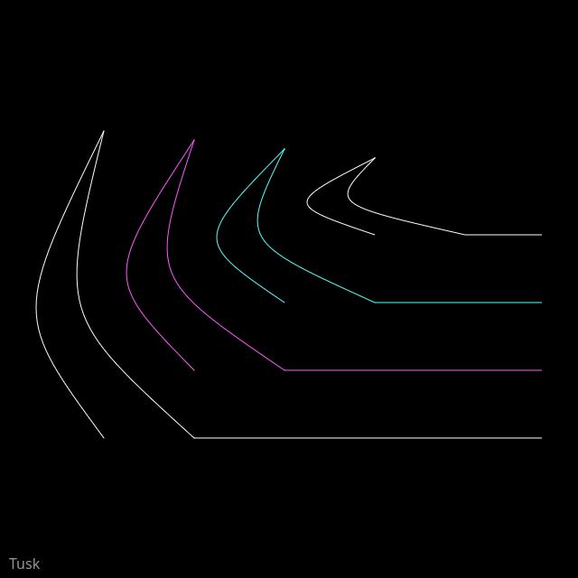

## Code

```javascript
const white = [255,255,255];
const cyan = [88, 255, 255];
const magenta = [255, 88, 255];
const colors = [white, cyan, magenta];

function setup() {
  createCanvas(640, 640);
  background(0);

  stroke(255);
  noFill();

  for (let i = 1; i < 5; ++i) {
    let h = 85 * i;
    let x = width-i*100-125;
    let y = 185 - i * 10;

    if (i === 3) {
      stroke(magenta);
    } else if (i == 2) {
      stroke(cyan);
    } else {
      stroke(white);
    }
    
    bezier(
      x, y,
      x-100, y+h*0.6,
      x-100, y+h*0.6,
      x, y+h
    );

    bezier(
      x, y,
      x-50, y+h*0.6,
      x-50, y+h*0.6,
      x+100, y+h
    );
  
    line(x+100, y+h, width-40, y+h);
  }

  noStroke();
  fill(255, 150);
  textSize(16);
  text("Tusk", 10, height - 10);
}

function draw() {
}

function keyPressed() {
  if (key == "s") {
    saveCanvas("tusk.png");
  }
}
```

## Discussion

Maybe I'm getting burned out but this prompt said nothing to me. Maybe if I was painting this or drawing it I would feel differently. It evokes a lot of "monster" type vibes but with this computer art project I'm feeling pretty flat on it. 

So what I ended up doing was starting with a single pair of bezier curves that looked a bit like a tusk. I turned this into a loop so I could draw a few of them of different sizes shifting left from the right side as it goes. I added lines to the right from each one and it started to feel like merging "tusk" with "claw". I like the story of the development of this piece but not the piece itself. I have trouble imagining some of these prompts from a more abstract perspective, it's easy to get caught up in a literal interpretation.