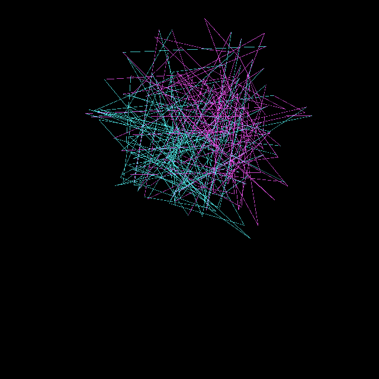
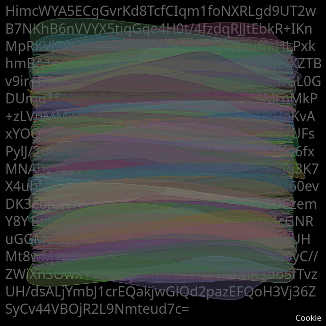
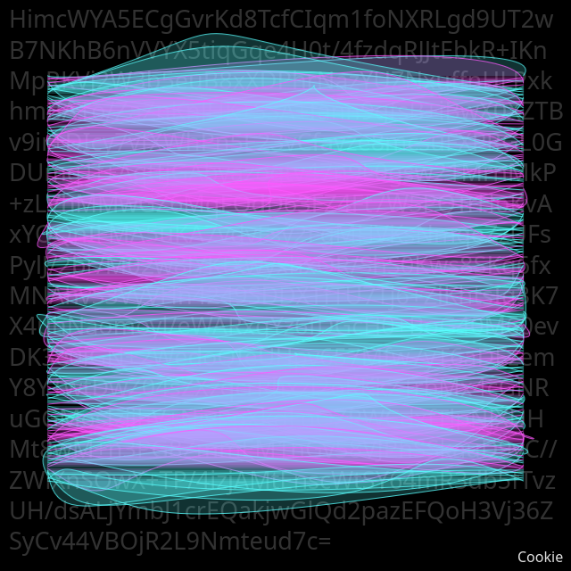

## Version 1

### Animated

<div id="canvas-container"></div>
<script src="https://cdn.jsdelivr.net/npm/p5@2.3.3/lib/p5.min.js"></script>
<script src="../../assets/js/gentober2026/day30.js"></script>

### Static



### Code

```javascript
const white = [255,255,255];
const cyan = [88, 255, 255];
const magenta = [255, 88, 255];
const colors = [white, cyan, magenta];

let content = "HimcWYA5ECgGvrKd8TcfCIqm1foNXRLgd9UT2wB7NKhB6nVVYX5tiqGqe4H0t/4fzdqRJJtEbkR+IKnMpRKVj2W3b5euB8xXDPhrNazYUZNxuffnHLPxkhmBA1o/ZaZnKnlHK+SSA+fann9gfsB+iBwX0XZTBv9ir+DIcy7vfXWhPn5E23vCfavze8mcsuFXPRGL0GDUmq1f+AqtfjGAbyazogtv47n9L0gsw21MrnMkP+zLVhMMwGZ6MqFQdD63FZ4Ft7W5PQTrHoKvAxYOQnIFMA5uKA7vdvFsy2FgMHVKsNmqeZzUFsPylJ/2br/M02w8lYKtXwyxhxOR/ShS0Kws8SKq6fxMNAhvS3VyVHn4249SDDXTfTU7Tj6+ZiKhtsIg3K7X4uhNaomoyl/eWARxgYz6fDGcH0+BoG40M60evDK3e0iGN+2WedoQIeUHpv657Mfw7yT6aDEzemY8Y1wtDwZ04sZXzqcrRhxzi2oRKkZTrbMx4cGNRuGGMoslzjihV+NiyPpXkgLoQZRWCdxfTlpNJXUHMt8wM+n3PG8ZmmEM1nGv58VJPhSSkauD9yC//ZWiXnSOwX+TP/4izjAMtEnscWtSY64mR3db5fTvzUH/dsALjYmbJ1crEQakjwGlQd2pazEFQoH3Vj36ZSyCv44VBOjR2L9Nmteud7c=";

async function setup() {
  createCanvas(640, 640, WEBGL);
  background(0);
  stroke(255);
  const encoder = new TextEncoder();
  content = encoder.encode(content);
}

let t = 0.001;

function snap(byteCoordinate) {
  return 2*map(byteCoordinate, 0, 255, -320, 320);
}

function draw() {
  background(0);
  stroke(255);
  noFill();

  rotateX(PI*t);
  rotateY(PI*t);
  rotateZ(PI*t);
  t += 0.001;

  let lastx = snap(content[0]);
  let lasty = snap(content[1]);
  let lastz = snap(content[2]);
  for (let i = 0, j = 0; i < content.length; i+=3, j++) {
    let x = snap(content[i]);
    let y = snap(content[i+1]);
    let z = snap(content[i+2]);

    let dWhite = dist(content[i], content[i+1], content[i+2], ...white);
    let dCyan = dist(content[i], content[i+1], content[i+2], ...cyan);
    let dMagenta = dist(content[i], content[i+1], content[i+2], ...magenta);

    if (dWhite < dCyan && dWhite < dMagenta) {
      // Note: interestingly none of the line segments are white
      stroke(...white, 200);
    } else if (dCyan < dWhite && dCyan < dMagenta) {
      stroke(...cyan, 200);
    } else {
      stroke(...magenta, 200);
    }
    
    line(
      lastx,
      lasty,
      lastz,
      x,
      y,
      z);
    lastx = snap(content[i]);
    lasty = snap(content[i+1]);
    lastz = snap(content[i+2]);
  }
}

function keyPressed() {
  if (key == "s") {
    saveCanvas("cookie.png");
  }
}
```

## Version 2



### Code

```javascript
const white = [255,255,255];
const cyan = [88, 255, 255];
const magenta = [255, 88, 255];
const colors = [white, cyan, magenta];

let content;

async function setup() {
  createCanvas(640, 640);
  background(0);

  const response = await fetch('encrypted-cookie.txt');
  content = await response.bytes();

  const decoder = new TextDecoder('utf-8');
  const t = decoder.decode(content);
  fill(255, 100);
  noStroke();
  textSize(27);
  textWrap(CHAR);
  text(t, 10, 10, 620, 620);
  
  const h = 2;
  const y = 85;
  for (let i = 0, j = 0; i < content.length; i+=3, j++) {
    fill(content[i], content[i+1], content[i+2], 100);
    stroke(content[i], content[i+1], content[i+2]);
    bezier(
      width/10, y+j*h,
      random(0, width), random(y+j*h - 100, y+j*h + 100),
      random(0, width), random(y+j*h - 100, y+j*h + 100),
      width-width/10, y+j*h,
    );
  }

  textSize(16);
  noStroke();
  fill(255, 225);
  text("Cookie", width-60, height - 10);
}

function draw() {
  
}

function keyPressed() {
  if (key == "s") {
    saveCanvas("cookie.png");
  }
}
```

## Version 3



### Code

```javascript
const white = [255,255,255];
const cyan = [88, 255, 255];
const magenta = [255, 88, 255];
const colors = [white, cyan, magenta];

let content;

async function setup() {
  createCanvas(640, 640);
  background(0);

  const response = await fetch('encrypted-cookie.txt');
  content = await response.bytes();

  const decoder = new TextDecoder('utf-8');
  const t = decoder.decode(content);
  fill(255, 50);
  noStroke();
  textSize(27);
  textWrap(CHAR);
  text(t, 10, 10, 620, 620);
  
  const h = 2;
  const y = 85;
  for (let i = 0, j = 0; i < content.length; i+=3, j++) {
    let dWhite = dist(content[i], content[i+1], content[i+2], ...white);
    let dCyan = dist(content[i], content[i+1], content[i+2], ...cyan);
    let dMagenta = dist(content[i], content[i+1], content[i+2], ...magenta);

    if (dWhite < dCyan && dWhite < dMagenta) {
      fill(...white, 50);
      stroke(...white, 200);
    } else if (dCyan < dWhite && dCyan < dMagenta) {
      fill(...cyan, 50);
      stroke(...cyan, 200);
    } else {
      fill(...magenta, 50);
      stroke(...magenta, 200);
    }
    
    bezier(
      width/12, y+j*h,
      random(0, width), random(y+j*h - 100, y+j*h + 100),
      random(0, width), random(y+j*h - 100, y+j*h + 100),
      width-width/12, y+j*h,
    );
  }

  textSize(16);
  noStroke();
  fill(255, 225);
  text("Cookie", width-60, height - 10);
}

function draw() {
  
}

function keyPressed() {
  if (key == "s") {
    saveCanvas("cookie.png");
  }
}
```

## Discussion

Today I have 3 versions of the prompt "cookie"! I'm going to come clean and admit that I started with versions 2 and 3 shown above before I got to the animated version 3 but since I liked the animation I switched them around to show the animation first. Anyway... I started by downloading my p5js editor session cookie and encrypting it using an ancient pkcs1 rsa private key. Then I took the encrypted output and used byte triplets as RGB values to define colors. I find the structure interesting in that cyan and magenta aren't all mixed together randomly, I can see roughly half the cube is one or the other, why is that the case?

Version 1 (the animated one) is the result of drawing lines from each byte triplet to another where the triplets were used as xyz coordinates in a 3-dimensional space. The color of the line is determined by the distance of the byte triplet coordinate from the white color triplet (255,255,255), this has the effect of "snapping" the color to white, cyan, or magenta based on it's distance. Interestingly I didn't see any white lines, they all ended up closer to magenta or cyan. I suspect this is because all the byte triplets are in the _middle_ of the potential number space?

Version 2 is the result of drawing filled bezier curves with some randomness for each byte triplet and using the triplet to define the actual color. They all turn out a bit muted. I also write the full text of the encrypted cookie in the background.

Version 3 is mostly the same as version 2 but with the colors snapped to white, cyan, and magenta like my other examples.