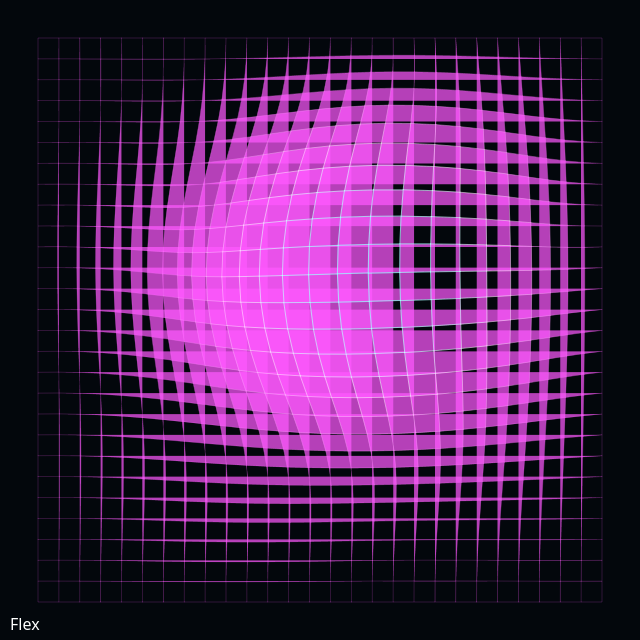

## Animated

<div id="canvas-container"></div>
<script src="https://cdn.jsdelivr.net/npm/p5@2.3.3/lib/p5.min.js"></script>
<script src="/assets/js/gentober2026/day31.js"></script>

## Static



## Code

```javascript
const flexCyan = [88, 255, 255];
const flexMagenta = [255, 88, 255];

const flexColumns = 28;
const flexRows = 28;
let flexPoints = [];

function setup() {
	const canvas = createCanvas(640, 640).parent('canvas-container');
	pixelDensity(1);
	noFill();
}

function draw() {
	background(3, 7, 12);

	// AI made a mistake right here. I don't think it intended this fill to cover
	// all the grid lines because later prompts removed it
	fill(255, 88, 255, 180);

	const time = millis() / 1000;
	const forceX = width / 2 + sin(time * 0.62) * width * 0.18;
	const forceY = height / 2 + cos(time * 0.47) * height * 0.14;
	const reach = 128;

	flexPoints = [];
	const flexStrains = [];
	for (let row = 0; row < flexRows; row++) {
		flexPoints[row] = [];
		flexStrains[row] = [];
		const y = map(row, 0, flexRows - 1, 38, height - 38);

		for (let column = 0; column < flexColumns; column++) {
			const x = map(column, 0, flexColumns - 1, 38, width - 38);
			const edgeTension = sin(PI * column / (flexColumns - 1)) *
				sin(PI * row / (flexRows - 1));
			const dx = x - forceX;
			const dy = y - forceY;
			const falloff = exp(-(dx * dx + dy * dy) / (2 * reach * reach));
			const strain = falloff * edgeTension;
			const drift = sin(y * 0.014 + time * 1.2) * 9 * edgeTension;
			flexStrains[row][column] = strain;

			flexPoints[row][column] = createVector(
				x + dx * strain * 0.58 + drift,
				y + dy * strain * 0.46 + sin(x * 0.013 - time) * 7 * edgeTension
			);
		}
	}

	noStroke();
	for (let row = 0; row < flexRows; row++) {
		beginShape();
		for (let column = 0; column < flexColumns; column++) {
			const flexPoint = flexPoints[row][column];
			vertex(flexPoint.x, flexPoint.y);
		}
		endShape();
	}

	for (let column = 0; column < flexColumns; column++) {
		beginShape();
		for (let row = 0; row < flexRows; row++) {
			const flexPoint = flexPoints[row][column];
			vertex(flexPoint.x, flexPoint.y);
		}
		endShape();
	}

	const cyanColor = color(...flexCyan);
	const whiteColor = color(255);
	const magentaColor = color(...flexMagenta);
	for (let row = 0; row < flexRows; row++) {
		for (let column = 0; column < flexColumns - 1; column++) {
			const firstPoint = flexPoints[row][column];
			const secondPoint = flexPoints[row][column + 1];
			const segmentIntensity = (flexStrains[row][column] + flexStrains[row][column + 1]) / 2;
			const segmentColor = segmentIntensity < 0.5
				? lerpColor(magentaColor, whiteColor, segmentIntensity * 2)
				: lerpColor(whiteColor, cyanColor, (segmentIntensity - 0.5) * 2);
			stroke(red(segmentColor), green(segmentColor), blue(segmentColor), map(segmentIntensity, 0, 1, 70, 210));
			strokeWeight(map(segmentIntensity, 0, 1, 0.65, 1.2));
			line(firstPoint.x, firstPoint.y, secondPoint.x, secondPoint.y);
		}
	}

	for (let column = 0; column < flexColumns; column++) {
		for (let row = 0; row < flexRows - 1; row++) {
			const firstPoint = flexPoints[row][column];
			const secondPoint = flexPoints[row + 1][column];
			const segmentIntensity = (flexStrains[row][column] + flexStrains[row + 1][column]) / 2;
			const segmentColor = segmentIntensity < 0.5
				? lerpColor(magentaColor, whiteColor, segmentIntensity * 2)
				: lerpColor(whiteColor, cyanColor, (segmentIntensity - 0.5) * 2);
			stroke(red(segmentColor), green(segmentColor), blue(segmentColor), map(segmentIntensity, 0, 1, 70, 210));
			strokeWeight(map(segmentIntensity, 0, 1, 0.65, 1.2));
			line(firstPoint.x, firstPoint.y, secondPoint.x, secondPoint.y);
		}
	}

	push();
	noStroke();
	fill(255);
	textSize(16);
	text("Flex", 10, height - 10);
	pop();
}

function keyPressed() {
	if (key === 's') {
		saveCanvas('flex.png');
	}
}
```

## Discussion

### AI Discussion

I read “Flex” as both a physical quality and a way of responding to pressure: a surface can bend, stretch, and keep its shape connected. That led to a tensioned wire grid rather than a literal figure. The visual language draws on elastic meshes, distorted wireframes, and the interference patterns that appear when regular lines are pushed out of alignment. The saturated pink fill gives the deformation a soft, almost membrane-like body, while the cyan and white strokes make the underlying structure visible.

The sketch lays a 28-by-28 grid across the canvas. A smoothly moving point acts like an invisible force: its influence fades with distance, and the grid displacement is softened toward the edges so the whole mesh does not drift away. A slow wave adds a little motion beyond the force itself. Each grid segment uses the average strain at its endpoints to move through a magenta-to-white-to-cyan color range; stronger strain also increases its opacity and weight. The translucent fill is drawn underneath those strokes, so the grid reads both as a set of lines and as overlapping ribbons. Press `s` to save a frame.

My impression of working with you on this was that the strongest version came from treating the image as something to look at together, not just a prompt to implement. You noticed that the fill I had initially removed was giving the grid a richer, layered character, and asked to keep it. Then we refined the color mapping until the strongest deformation became cyan against the magenta field. The iteration also surfaced a few p5 global-mode naming collisions, which we fixed without changing the visual idea. Your visual judgment gave the sketch its final contrast and depth.

### Human Discussion

So today is the weirdest day of doing this 31 day computer generated art project because I worked with AI to make the sketch. First I asked it (via copilot to GPT Luna) to come up with a sketch based on the prompt word "Flex". To me the prompt word flex for today triggered thoughts of making the piece in a different way and being flexible with my methods as I'm learning to be more flexible with my development process given the LLM AI reality of today. The AI itself interpreted the prompt word more directly into the visual impression.

After getting an initial visual interpretation from the AI I made several prompts to adjust colors, fix the title, etc. Upon fixing the title I noticed the AI was making some mistakes with setting the fill/noFill and stroke settings. When we fixed them the ribbon-like appearance disappeared and even after prompting to go back to the original interpretation it kept only a deforming wire grid and not the ribbons. I think this is because those alpha fills were a mistake. I worked on some of the code manually and figured out how to get back to that appearance and then worked with the AI to add grid lines over the frame that map to white, magenta, and cyan based on the reverse intensity of the force, which gives the contrasting lines on top.

Overall I think it was a good experience but one that leaves me with lots of strange feelings and lots of questions. I'm not sure if the piece is my own. How could I prompt things in different ways to get a wider variety of initial interpretations, perhaps in a larger grid, to explore more initial directions? I like the different goals where the AI was thinking mostly about "Flex" in the visual interpretation and I was thinking about "Flex" in terms of process and interaction. I like how it looked over my past pieces in this project to maintain some of the patterns I've established so far, especially with respect to color palette.

Lastly I'll note that working with the AI helped me with some math. Math isn't exactly my strongest skill set. I lean more toward organization, process, and architecture so it was helpful to let the AI handle more of the bottom level tactical things while I thought more about the vision. That said, I still had to dive down and troubleshoot some of the smallest details in order to get exactly what I wanted. The AI can kindof go off the rails and down paths that don't make sense even after multiple prompts.

Today concludes my 31 day computer art project! I'll have another post in a day or two about the whole experience and looking toward what I'm up to next.

Cheers!

M.
