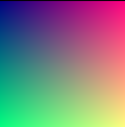

# Largest

## Large

```javascript
let x = 14;
console.log(`${x}`);
```

<script src="https://cdn.jsdelivr.net/npm/p5@2.3.3/lib/p5.min.js"></script>
<script>
const white = "#fff";
const cyan = "#55ffff";
const magenta = "#ff55ff";
const colors = [white, cyan, magenta];

// Mover from Nature of Code
class Mover {
  constructor(x, y, m) {
    this.mass = m;
    this.radius = m * 1;
    this.position = createVector(x, y);
    this.velocity = createVector(0, 0);
    this.acceleration = createVector(0, 0);
    this.heat = 100;
  }

  applyForce(force) {
    let f = p5.Vector.div(force, this.mass);
    this.acceleration.add(f);
  }

  update() {
    this.velocity.add(this.acceleration);
    this.position.add(this.velocity);
    this.acceleration.mult(0);
    this.heat -= 3;
  }

  show() {
    stroke(255, map(this.heat, 0, 100, 255, 88), 255, map(this.heat, 100, 0, 255, 80));
    strokeWeight(2);
    fill(127, 127);
    circle(this.position.x, this.position.y, this.radius * 2);
  }

  contactEdge() {
    return (this.position.y > height - this.radius - 1);
  }

  bounceEdges() {
    let bounce = -0.5;
    if (this.position.x > width - this.radius) {
      this.position.x = width - this.radius;
      this.velocity.x *= bounce;
    } else if (this.position.x < this.radius) {
      this.position.x = this.radius;
      this.velocity.x *= bounce;
    }
    if (this.position.y > height - this.radius) {
      this.position.y = height - this.radius;
      this.velocity.y *= bounce;
    }
  }

}

let particles = [];

function setup() {
  createCanvas(640,640);
  background(0);

  let x = random(width/5, width-width/5);
  let y = random(height/5, height/2);
  fill(magenta);
  stroke(magenta);
  circle(x, y, 5);
  
  for (let i = 0; i < 25; i++) {
    particles.push(new Mover(x, y, 1));
  }
}

function showTitle() {
  // Title
  strokeWeight(1);
  stroke(0);
  fill(cyan);
  textSize(16);
  text("Hooray", 10, height-10);
}

let firstTime = true;

function draw() {
  for (let i = 0; i < particles.length; i++) {
    let mover = particles[i];
    let gravity = createVector(0, 1);
    mover.applyForce(gravity);

    if (firstTime) {
      mover.applyForce(createVector(random(-20,20), random(-25,5)));
    }
  
    if (mover.contactEdge()) {
      let c = 0.1;
      let friction = mover.velocity.copy();
      friction.mult(-1);
      friction.setMag(c);
  
      mover.applyForce(friction);
    }
  
    mover.bounceEdges();
    mover.update();
    mover.show();
  }

  showTitle();
  firstTime=false;
}

function keyPressed() {
  if (key == "s") {
    saveCanvas("hooray.png");
  }
}
</script>

### image


